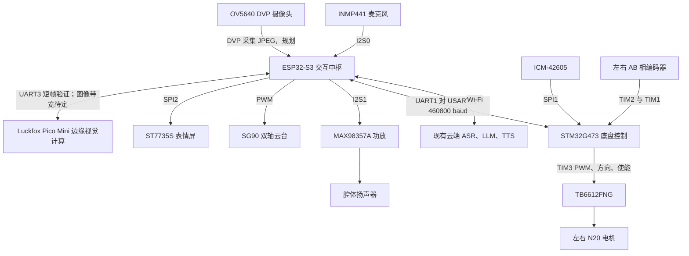
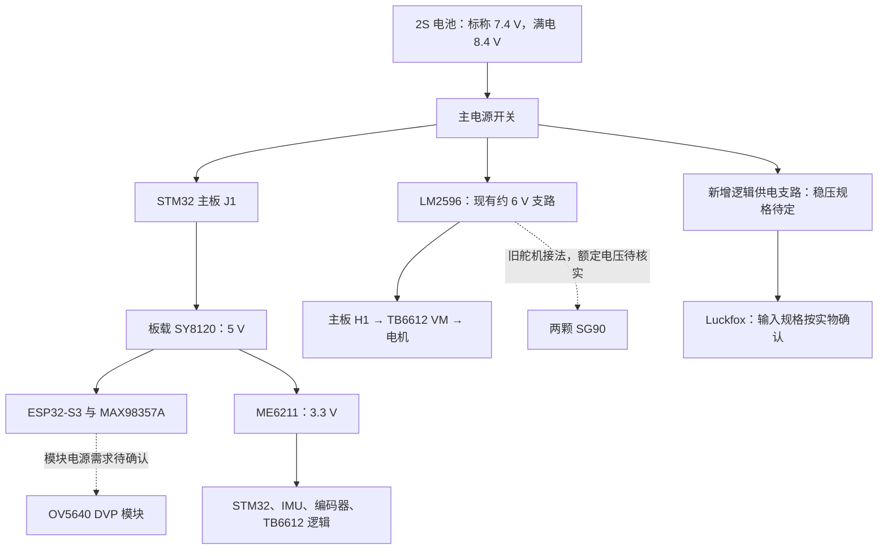

# 桌面机器人 2.0 升级方案与硬件建模测量清单

> 版本：2.0 规划草案  
> 更新日期：2026-10-17
> 当前阶段：旧机械框架已拆除，旧 CAD 已删除；以实物重新测量、从零设计并 3D 打印骨架。  
> 当前拟定视觉路线：OV5640 DVP 接 ESP32-S3 采集；Luckfox Pico Mini 做边缘推理；图像如何从 ESP32 送到 Luckfox 尚待带宽与接口验证，UART3 先只做短帧通信，识别结果再返回 ESP32-S3。

2.0 的目标是一台能够自平衡、看向使用者、转头跟随、显示表情并进行语音对话的桌面机器人。先用可调、可拆的开放式骨架完成机械和视觉验证，再制作外壳。本文汇总现有硬件、接线、待测尺寸及升级步骤，作为重新装配和建模的工作底稿。

## 1 当前基础与升级范围

### 1.1 当前状态

- 现有系统使用 STM32G473RCT6 负责底盘，ESP32-S3 负责交互和网络。
- 2026-10-02 的接线与进度文档记录电机、编码器、IMU、屏幕、云台和音频外设已完成实物测试；拆装后需重新检查连接和方向。
- 用户此前进行过 PID 调试，效果不理想；原结构存在底盘低、机械搭建简陋等问题，现已拆除。
- 当前底盘代码保留自平衡算法 `control_step()`，但主循环实际调用差速速度控制和定距定角走位。恢复两轮站立时，需要重新接入自平衡闭环并确认保护逻辑。
- 当前电池遥测值固定为 `12100 mV`，不是实际 ADC 电压，不能用于判断 2S 电池电量；硬件分压接口存在，软件采样待实现。

### 1.2 2.0 的产品目标

成品采用双轮躯干和可转动头部。头部安装表情屏与摄像头，麦克风采集语音，扬声器播放回复；躯干容纳电池、三块计算控制板及电源模块，底部为左右电机和轮子。

| 能力 | 2.0 目标 | 完成判断 |
| --- | --- | --- |
| 机械装配 | 开放式打印骨架，可拆电池、头部和电子托板 | 无松动和线束干涉，接口可访问 |
| 自平衡 | 固定载荷下站稳，再逐步加入转头和移动 | 记录稳定站立时长、漂移和恢复表现，验收阈值在实测前确定 |
| 视觉互动 | 检测到人后看向人脸，缓慢转头跟随 | 实测有效检测率、端到端延迟及目标丢失行为 |
| 声画联动 | 对话时显示表情，播放语音并配合轻量动作 | 视觉任务与现有语音、屏幕可同时运行 |
| 运动交互 | 平衡稳定后增加低速转向、短距离走位 | 遥控急停和链路超时停机可重复验证 |

视觉第一版只要求人脸检测和位置跟踪。身份识别、复杂手势、云端看图对话及自主跟随作为后续扩展。单目摄像头不承担可靠测距与桌边防跌落职责；无桌边保护前，运动调试放在地面测试区进行。

## 2 硬件清单

“已有”按仓库现有实机记录整理；“新购”按本次沟通确认。旧采购计划中的器件不自动视为已安装。

| 编号 | 硬件 | 数量 | 规格与作用 | 状态 |
| --- | --- | --- | --- | --- |
| H01 | STM32 主控 PCB | 1 | STM32G473RCT6；底盘实时控制 | 已有，实际 PCB 外形待测 |
| H02 | ESP32-S3 开发板 | 1 | 旧文档记录 DevKitC-1 N16R8，16 MB Flash、8 MB PSRAM | 已有，板型和排针以实物复核 |
| H03 | ICM-42605 | 1 | 六轴 IMU，位于主控 PCB | 已有，作为主板整体建模 |
| H04 | TB6612FNG 模块 | 1 | 双路直流电机驱动 | 已有 |
| H05 | N20 编码器减速电机 | 2 | 旧采购记录为 6 V、300 RPM、AB 相编码器 | 已有，核对实物型号和减速比 |
| H06 | 轮子及金属电机支架 | 各 2 | 轮轴适配与电机固定；商品为 12GA-N20 带编码器套装 | 已有，轮径/宽度已有实测；电机本体和编码器尾部按商品版本复核 |
| H07 | 2S 锂电池包 | 1 | 旧采购记录为 7.4 V、1800 mAh；满电 8.4 V | 已有，标签和尺寸待复核 |
| H08 | LM2596 可调降压模块 | 1 | 现有电机与舵机电源支路 | 已有 |
| H09 | SY8120 与 ME6211 电源电路 | 各 1 路 | 主板上 5 V、3.3 V 电源 | 按主板记录，新增负载余量待核算 |
| H10 | ST7735S TFT 屏 | 1 | 1.8 英寸，128×160，表情显示 | 已有；早期 OLED 方案已被替代 |
| H11 | SG90 舵机及双轴云台件 | 2 个舵机 | 水平转头和俯仰；商品图为常见 9g SG90 双自由度云台套件 | 已有；SG90 本体网上常见约 23 × 12.2 × 29 mm，云台套件外形和孔距待按具体商品复核 |
| H12 | INMP441 麦克风模块 | 1 | I2S 语音输入 | 已有 |
| H13 | MAX98357A 功放模块 | 1 | I2S 音频输出 | 已有 |
| H14 | 3525 腔体扬声器 | 1 | 旧采购记录为 4 Ω、3 W | 已有，3525 是商品规格，不能替代实测外形 |
| H15 | 开关、线束、电容、紧固件 | 若干 | 主开关、470 μF/16 V 电容、M2/M3 等 | 已有物料需盘点 |
| H16 | W25Q128 | 1 | 原理图中的板载扩展 Flash | 是否实际焊装、启用待确认 |
| H17 | OV5640 DVP 摄像头模块 | 1 | 500 万像素；本地资料显示为带板载 24 MHz 晶振的 DVP 模组 | 模组针序可参考本地应用资料；供电仍须按实物板卡确认 |
| H18 | Luckfox Pico Mini（RV1103）开发板 | 1 | 用户已确认板型为 Pico Mini；官方表列 Mini A/B 均有 2-lane MIPI CSI 摄像头接口 | A/B 具体版本、默认存储和焊接排针状态待按实物丝印确认 |
| H19 | VL53L0X 等测距器件 | 待确认 | 旧文档中的扩展计划 | 不计入已安装硬件 |

官方把 Pico Mini A/B 归在 RV1103 系列；具体内存和存储配置以板面丝印、订单和对应资料为准。模型必须适配该芯片，不能仅按算力数字判断运行效果。[Luckfox Pico Mini 官方手册](https://wiki.luckfox.com/zh/Luckfox-Pico-Plus-Mini/)

## 3 硬件架构

### 3.1 功能与数据流

图中“规划”表示需要新增的连接或功能，不代表目前已经接线完成。



目标是让 Luckfox 处理本地视觉检测；OV5640 到 ESP32-S3 的 DVP 采集按本地模组资料规划，ESP32 到 Luckfox 的图像传输仍需另行验证，UART3 首先只做短帧联调。现有云端语音识别、大模型和语音合成链路继续作为交互基础。STM32 独立维持实时控制，视觉超时或 Linux 任务阻塞不能阻塞姿态采样和电机控制。

### 3.2 视觉传输方案

| 环节 | 规划 | 待验证项 |
| --- | --- | --- |
| 摄像头接 ESP32-S3 | OV5640 DVP；本地示例使用 ESP32-S3 DVP 驱动 | 模块供电、针序、GPIO 与外设资源共存；示例 GPIO 与现有固件有冲突 |
| ESP32-S3 接 Luckfox | Pico Mini UART3（物理针脚 12/13）先做短帧验证 | 确认系统已启用 `/dev/ttyS3`、引脚复用、电平、传输带宽 |
| 持续人脸跟踪 | UART 短帧通过后，单独评估 SPI 或网络图像链路 | Luckfox Linux 驱动、主从角色、片选、流控、带宽及 ESP32 引脚预算 |
| Luckfox 输入处理 | JPEG 解码、缩放、按模型要求预处理 | 解码耗时、内存占用、RKNN 模型兼容性 |
| 返回结果 | 帧编号、时间戳、目标框、类别、置信度 | 丢包、结果过期、多目标选择策略 |

UART 只是验证链路的候选，不预先承诺跟踪帧率。例：假设每帧为 30,000 字节 JPEG，921600 baud、8N1 下仅发送约需 `30000 × 10 / 921600 ≈ 0.326 秒`，尚未包含其他耗时；实际 JPEG 大小随场景和质量变化。

优先处理最新帧，设置队列长度上限和结果有效期；积压的旧帧直接丢弃。帧率、延迟和质量参数通过实测确定。乐鑫驱动支持 ESP32-S3 与 OV5640，并建议在内存带宽紧张时优先采集 JPEG。[esp32-camera 官方说明](https://github.com/espressif/esp32-camera)

### 3.3 供电结构



新增支路是规划，不表示必须立刻购买电源模块。先测量现有 5 V/3.3 V 支路在 Wi-Fi、音频、摄像头和 Luckfox 工作时的电流、压降及温升，再决定能否共用或需要独立稳压。所有逻辑通信设备共地，动力和舵机大电流回路避免经开发板排针串接回流。

旧记录中 LM2596 输出约 6.0～6.12 V，同时供电机和舵机；2.0 不直接把此值作为 SG90 的额定标准，需核对实际舵机资料。摄像头模块是否带稳压、各电源输入要求，以及 Luckfox 供电端子定义都需核实后才能接电。

## 4 现有接线表与重新装配顺序

### 4.1 如何理解接线顺序

以下模块表按接线检查顺序排列；除已标明的主板连接器编号外，表格行号不代表排针从左到右的物理针号。查看排针时必须记录正反面、1 脚标记和丝印，不能仅靠线色判断。

接线基准采用 [08 全机实物接线总览](../桌面自平衡机器人/08-全机实物最终接线总览与电气防烧指南.md)，软件实际分配核对 [ESP32 配置](../../firmware_brain/main/config/board_config.hpp) 和 STM32 驱动。更早的原理图草案存在不同映射，复装不能混用不同版本。

### 4.2 电源与跨芯片串口

| 起点 | 终点 | 说明 |
| --- | --- | --- |
| 电池正极 | 主开关 → 分配节点 → 主板 J1-1 | VBAT；不直接接 ESP32 或 Luckfox |
| 电池负极 | 主板 J1-2、系统公共 GND | 共地 |
| 开关后的 VBAT / GND | LM2596 IN+ / IN− | 降压模块输入 |
| LM2596 OUT+ / OUT− | 主板 H1-1 / H1-2 | 电机 VM 支路；输出电压先确认 |
| 主板 J_ESP32-1 | ESP32 5V | 独立运行供电；USB 调试时须核对电源切换和防倒灌方案 |
| 主板 J_ESP32-2 | ESP32 GND | 公共地 |
| 主板 J_ESP32-3，STM32 PA2 TX | ESP32 GPIO8 RX | 底盘向大脑上报 |
| 主板 J_ESP32-4，STM32 PA3 RX | ESP32 GPIO7 TX | 大脑向底盘下发 |

当前代码为 **ESP32 UART1 ↔ STM32 USART2，460800 baud**。旧文档把 ESP32 端也称为 UART2，2.0 以代码配置为准。主板连接器朝向与 1 脚位置复装时按实物再次确认。

### 4.3 ESP32 外设

| 模块 | 模块引脚 | ESP32 或电源端 | 备注 |
| --- | --- | --- | --- |
| ST7735S | GND | GND | 公共地 |
| ST7735S | VCC | 模块允许的供电输入，待复核原接法 | 旧表写 3.3 V 或 5 V，须以实际模块为准 |
| ST7735S | SCL / SCLK | GPIO12 | SPI2 时钟 |
| ST7735S | SDA / MOSI | GPIO11 | SPI2 数据 |
| ST7735S | RES / RST | GPIO10 | 复位 |
| ST7735S | DC | GPIO13 | 数据命令选择 |
| ST7735S | CS | GPIO14 | 片选 |
| ST7735S | BLK | GPIO21 | 背光控制 |
| SG90 水平轴 | 信号 | GPIO1 | 当前水平控制 |
| SG90 俯仰轴 | 信号 | GPIO2 | 当前俯仰控制 |
| 两颗 SG90 | 电源正 / 负 | 外部舵机支路 / GND | 不由 ESP32 排针承担舵机动力；额定电压待确认 |
| INMP441 | VDD / GND | 3.3V / GND | 不接 5 V |
| INMP441 | SD | GPIO4 | I2S0 输入 |
| INMP441 | WS | GPIO5 | 字时钟 |
| INMP441 | SCK | GPIO6 | 位时钟 |
| INMP441 | L/R | GND | 左声道 |
| MAX98357A | VIN / GND | 5V / GND | 不接约 6 V 电机支路 |
| MAX98357A | DIN | GPIO15 | I2S1 输出 |
| MAX98357A | BCLK | GPIO16 | 位时钟 |
| MAX98357A | LRC | GPIO17 | 字时钟 |
| MAX98357A | GAIN、SD_MODE | 原实机记录为悬空 | 以实际模块默认电路核对 |
| MAX98357A | SPK+ / SPK− | 扬声器两端 | 两端均不接系统 GND |

屏幕使用 SPI，虽然模块丝印可能为 SDA/SCL，也不是 I2C 接线。麦克风和功放目前分别使用 I2S0、I2S1，不按早期文档的“共用时钟”方案改接。

### 4.4 TB6612 与电机

| 主板 J2 针号 | 网络或 STM32 引脚 | TB6612 引脚 |
| --- | --- | --- |
| 1 | VM_6V | VM |
| 2 | +3V3 | VCC |
| 3 | GND | GND |
| 4 | PC6，TIM3_CH1 | PWMA |
| 5 | PC8 | AIN1 |
| 6 | PC9 | AIN2 |
| 7 | PC7，TIM3_CH2 | PWMB |
| 8 | PA15 | BIN1 |
| 9 | PB0 | BIN2 |
| 10 | PB1 | STBY |

当前 `motor.c` 实际使用 TIM3；旧记录中出现的 TIM8 不作为当前配置。旧实机线色记录为：左电机白线接 AO1、红线接 AO2；右电机白线接 BO1、红线接 BO2。拆装后仍须低功率确认正转方向，线色只作追溯。

### 4.5 编码器、板载传感器和调试

| 接口 | 针号或信号 | 连接 |
| --- | --- | --- |
| J_ENC_L | 1 / 2 | +3V3 / GND；旧线色为黑 / 蓝 |
| J_ENC_L | 3 / 4 | PA0 / PA1，TIM2_CH1 / CH2；旧线色为绿 / 黄 |
| J_ENC_R | 1 / 2 | +3V3 / GND；旧线色为黑 / 蓝 |
| J_ENC_R | 3 / 4 | PA8 / PA9，TIM1_CH1 / CH2；旧线色为绿 / 黄 |
| ICM-42605 | CS / SCK / MISO / MOSI | PA4 / PA5 / PA6 / PA7，板载 SPI1 |
| ICM-42605 | INT1 | PC4，硬件连接记录；不据此认定当前软件使用中断或 DMA |
| 电池采样 | BAT_SENSE | PC0，板载分压；软件 ADC 待实现 |
| W25Q128 | CS / SCK / MISO / MOSI | PB12 / PB13 / PB14 / PB15，按原理图记录，焊装与启用待确认 |
| SWD | SWDIO / SWCLK / GND | PA13 / PA14 / GND |
| SWD | 3.3 V 参考、可选 NRST | 按烧录器与实际接口确认；不默认由烧录器供整车电 |

SWD 旧资料有 4 针与 5 针两个版本，NRST 是否引出和实体针序需要查看实际 PCB。IMU 当前驱动为 SPI 寄存器轮询收发；不能沿用旧文档中的“已实现 1000 Hz DMA”作为软件现状。

### 4.6 推荐重新装配顺序

1. 断开所有电源，拍摄模块正反面与线束，标出连接器 1 脚和正负极。
2. 单独确认主板、降压模块输出；核实主板供电与 USB 调试的切换方式。
3. 连接 STM32、IMU 和编码器，手动转轮检查读数与方向。
4. 接 TB6612 和电机，让轮子悬空，低功率检查正反转、停机和急停。
5. 接 ESP32 与 STM32 串口，验证心跳及遥测。
6. 按屏幕、麦克风、功放、舵机的顺序恢复交互外设，每接一项单独验证。
7. 在完成新引脚分配后接 OV5640，单独验证采集，再接 Luckfox 验证传输与推理。
8. 最后进行全负载供电测试和地面整机联调，记录压降、温升和异常复位。

## 5 新硬件接线与资源待办

### 5.1 OV5640 DVP

这是信号需求表，**不是已定稿 GPIO 接线表**。模块物理针号、供电与 RESET/PWDN 极性，按实际转接板资料填写。部分模块将八位数据标作 D2～D9，应按输出位序映射到驱动 D0～D7，不能仅凭名字逐字连接。

| 摄像头信号 | 相对 ESP32 的方向 | ESP32 GPIO | 待登记内容 |
| --- | --- | --- | --- |
| D0～D7，共 8 位 | 输入 | 待分配 | 实际模块数据位命名、针号 |
| PCLK | 输入 | 待分配 | 像素时钟 |
| VSYNC | 输入 | 待分配 | 帧同步 |
| HREF / HSYNC | 输入 | 待分配 | 模块采用的行有效信号 |
| XCLK | 输出 | 待分配 | 时钟资源不能与舵机 LEDC 配置冲突 |
| SCCB SDA / SIOD | 双向 | 待分配 | 配置总线 |
| SCCB SCL / SIOC | 输出 | 待分配 | 配置总线 |
| RESET、PWDN | 通常为控制输出，视模块而定 | 待确认是否需要 | 是否模块已固定电平、是否占用额外 GPIO |
| 电源、GND | 电源 | 不适用 | 模块稳压与逻辑电平，禁止按裸传感器或其他转接板推断 |

### 5.2 ESP32 与 Luckfox

| 连接 | 方案状态 | 物理针号 |
| --- | --- | --- |
| ESP32 TX → Luckfox UART3_RX | 短帧验证链路，独立于底盘串口 | Luckfox Pico Mini 物理针脚 13（GPIO1_D1）；ESP32 端 GPIO 待分配 |
| ESP32 RX ← Luckfox UART3_TX | 返回检测结果、流控与状态 | Luckfox Pico Mini 物理针脚 12（GPIO1_D0）；ESP32 端 GPIO 待分配 |
| GND ↔ GND | 必需 | Luckfox 物理针脚 2 或 21；ESP32 接公共地 |
| SPI SCLK / MOSI / MISO / CS | 持续传图候选，未定稿 | 待确认可用控制器、主从支持、复用和引脚 |
| 可选 READY / IRQ | 仅在最终协议需要时加入 | 待分配 |
| Luckfox 电源 | 按确切板型的输入定义设计 | 待核实，不能向 GPIO 灌入供电电压 |

### 5.3 GPIO 预算与接线定稿门槛

当前 ESP32 配置已占用 16 个信号 GPIO：`1、2、4、5、6、7、8、10、11、12、13、14、15、16、17、21`。标准八位 DVP 加 SCCB 通常还需 14 个信号，RESET/PWDN 可能继续增加；Luckfox UART 另需 2 个，SPI 通常至少 4 个。

因此不能默认保留全部现有接线后，仍能直接接齐新外设。须按实际开发板排针清点可用 GPIO，剔除 Flash/PSRAM 占用，评估启动配置脚、USB、下载串口与调试保留需求，再检查摄像头 DMA、时钟和驱动资源共存。任何重新分配都要同步更新代码配置和此表。

- [ ] 登记 ESP32、Luckfox Pico Mini 的 A/B 版本及 OV5640 模组实物照片和接口定义。
- [ ] 画出全量 GPIO 分配表，确认电压、方向、上电默认状态与外设复用。
- [ ] 若资源不足，先评估释放屏幕辅助控制脚、调整外设分工或增加专用采集板；作为待决策方案，不视为已购买。
- [ ] 确认摄像头 XCLK 使用的时钟资源与舵机 PWM 不冲突。
- [ ] 确认 Luckfox 系统中的串口/SPI 驱动和实际可用引脚，再选通信通道。
- [ ] 图像采集与音频、屏幕、Wi-Fi 同时工作通过后，冻结新接线。

### 5.4 新增摄像头与 Luckfox 首次接线顺序

下面是新增硬件的**实际操作顺序**。Luckfox Pico Mini 的 UART3 板端针脚已按官方 Mini 专用针脚图确认；ESP32 端 GPIO、摄像头 DVP GPIO 和电源针脚仍须按实物与资源审计定稿。

#### A. 断电登记和电气确认

1. 断开 2S 电池、USB 和所有外部电源，分别拍摄 ESP32-S3、OV5640、Luckfox 的正反面。
2. 在三块板上标出 `GND`、电源输入、`TX/RX`、摄像头数据位和连接器 1 脚。不要只按排针左右顺序认针脚。
3. 查清 OV5640 模块 VCC 输入规格和逻辑电平；本地示例 README 标注 VCC 为 3.3 V，但要求先核对实物。查清 Luckfox Pico Mini 的供电输入；未确认前不把 5 V 或电池电压接到信号脚。
4. 用限流电源单独测量各模块的空载电流和上电电压。新增模块不从 ESP32 GPIO 取电，也不把 2S 电池直接接到它们。

#### B. 先单独启动 Luckfox

5. 只连接 Luckfox 的确认过的电源和 `GND`，先不接 OV5640、ESP32 或电机系统。
6. 通过 USB/调试串口启动 Linux，确认能稳定启动、识别板型、登录系统，并记录板载串口和可用 GPIO。
7. 官方 Pico Mini 针脚图给出的 UART3 为物理针脚 12 `UART3_TX`（GPIO1_D0）和针脚 13 `UART3_RX`（GPIO1_D1）；针脚 2/21 为 GND。UART2 是调试串口，不用作本链路。系统侧确认 `/dev/ttyS3` 已启用，并确认 UART 信号电平；这一步只做串口回环和短帧验证，不传视频流。[UART 官方页](https://wiki.luckfox.com/zh/Luckfox-Pico-Plus-Mini/UART/) · [Mini 专用针脚图](https://wiki.luckfox.com/zh/assets/images/LUCKFOX-PICO-MINI-GPIO-dd48b2490c683f3a1bafc86f54bf1e6e.webp)

#### C. 再单独验证 OV5640 到 ESP32-S3

8. 现有 OV5640 是 DVP 模组，先只按模块针序接 ESP32-S3，不要插进 Luckfox 的 CSI 排线座。至少登记 `D0-D7`、`PCLK`、`VSYNC`、`HREF`、`SCCB_SDA`、`SCCB_SCL` 和电源；本地资料显示该模组有板载 24 MHz 晶振时 `XCLK` 不接，`RESET/PWDN` 按实物和驱动确定。
9. 本地 ESP32-S3 摄像头示例映射为 D0-D7→GPIO4-11、PCLK→12、VSYNC→13、HREF→14、SDA/SCL→16/17、PWDN→18、RESET→21；但这些 GPIO 与机器人现有音频、屏幕等配置冲突，**不能照抄直接接线**。先完成 GPIO 重分配并更新 `board_config.hpp`。DVP 数据位须按模块针序映射，不能仅凭 `D2-D9` 名称推断。
10. 只运行摄像头探测和低分辨率采集：先读 OV5640 ID，再采集低分辨率 JPEG，确认画面稳定、帧号递增和无明显花屏。此时暂不接 Luckfox。

#### D. 最后建立 ESP32-S3 到 Luckfox 的通信

11. 第一阶段用 Luckfox UART3 做短帧通信验证：`Luckfox 物理针脚 12 (UART3_TX) -> ESP32 RX`；`Luckfox 物理针脚 13 (UART3_RX) <- ESP32 TX`；Luckfox 针脚 2 或 21 `GND -> ESP32 GND`。TX/RX 必须交叉；接线前用万用表或逻辑分析仪确认上电信号电平，不能接 RS-232 电平或 5 V UART。
12. ESP32 端 UART 的 GPIO 不能占用当前底盘串口 GPIO7/8、屏幕 SPI GPIO11/12/13/14、音频 GPIO4/5/6/15/16/17、舵机 GPIO1/2 和背光 GPIO21。具体 GPIO 先填入资源表，再同步到 `board_config.hpp`，不能临时飞线后忘记记录。
13. 两板先用 `115200 8N1` 发送固定短帧，验证收发、校验、超时和断线处理；稳定后再逐步提高波特率。不要一开始就承诺 921600 或持续传完整 JPEG。
14. UART 短帧通过后，先定义结果回传协议（帧编号、类别、置信度、目标框）。若只做低频验证，可再试传小尺寸 JPEG；连续跟踪所需的图像链路需先确定更高带宽方案。队列只保留最新帧，过期结果丢弃。

#### E. 整机合并顺序

15. 先保持电机、舵机和 2S 电池断开，只接 `ESP32 + OV5640 + Luckfox`，验证 ESP32 摄像头采集和 UART 短帧往返，记录供电电压、峰值电流、温升和异常重启。图像送入 Luckfox 的链路单独验证通过后，再做端到端推理测试；不要把 UART 短帧测试当成视频链路已打通。
16. 再接回 ST7735S、麦克风、功放和云台，确认图像任务不会抢占现有音频、屏幕和舵机资源。
17. 最后接 STM32 底盘串口、TB6612、电机和电池。先悬空轮子验证急停与通信超时，再进入地面测试；视觉链路异常时 STM32 必须仍能独立停机和保持安全状态。
18. 完成一次全负载测试后，把实际板型、供电、GPIO、线序、波特率和协议版本回填到本节，并将“待分配/待确认”勾选为已验证。

#### 新增硬件接线记录表

| 链路 | 当前阶段 | 必须记录 | 不能默认的内容 |
| --- | --- | --- | --- |
| OV5640 电源 | 待核对 | 模块输入电压、是否带稳压、峰值电流 | 不能默认接 5 V 或 3.3 V |
| OV5640 -> ESP32 DVP | 接口类型与本地示例已知；本项目 GPIO 待重新分配 | D0-D7、PCLK、VSYNC、HREF、SCCB、RESET/PWDN、电源 | 示例 GPIO 与现有固件冲突，不能直接照抄 |
| ESP32 -> Luckfox UART3 | 板端针脚已确认；等待 ESP32 GPIO 分配和系统验证 | Luckfox 12=TX、13=RX；ESP32 TX/RX；电平、波特率、帧格式 | TX/RX 交叉；不可占 UART2 调试口，不能接 RS-232/5 V UART |
| Luckfox 电源 | Pico Mini 已确认；输入端和峰值电流待按实物核对 | A/B 版本、输入端、峰值电流、散热 | 不能从 ESP32 排针或电机支路直接取电 |
| 两板公共地 | 必需 | GND 连接点和回流路径 | 不能让电机/舵机大电流通过信号地线回流 |

### 5.5 使用 GND 分线器后的实际接法

GND 分线器可以把多个模块的地线汇到同一个公共参考点，但它**不节省 GPIO**，也不能代替电源稳压。建议把它作为逻辑系统的星形地汇流点：

```text
电源分配节点 GND
        |
        +-- GND 分线器 -- ESP32-S3 GND
        |              -- Luckfox GND
        |              -- OV5640 GND
        |              -- STM32/主控板 GND
        |              -- ST7735S、INMP441、MAX98357A 信号地
        |
        +-- 独立回路 -- TB6612 功率地
                       -- 两个电机回路地
                       -- SG90 舵机电源地
```

接线时按以下规则执行：

1. 电池负极先进入主电源分配节点，再从该节点分别接逻辑地和动力地；不要让电机或舵机的大电流回流经过 ESP32 排针、面包板细线或摄像头排线。
2. OV5640、Luckfox 和 ESP32 的 UART 信号必须共享同一个 GND 分线器，否则 TX/RX 电平没有可靠参考。
3. GND 可以共用，`3.3 V`、`5 V` 不能因为有分线器就直接并接；各模块仍要按实际输入规格供电，并在模块附近放置去耦电容。
4. 先接地线，再接信号线，最后接电源线；断电时反向操作。任何模块的电源电压没有确认前，只接 GND 和信号检查，不上电。

GND 整理好之后，GPIO 仍按以下策略处理：

- OV5640 的 `RESET/PWDN` 若模块资料允许固定电平，可用上拉/下拉电阻固定，释放 1～2 个 GPIO；不能直接短接到不确定的电源电平。
- ST7735S 若确认它是系统中唯一的 SPI 从设备，`CS` 可以按模块资料固定为有效电平；`BLK` 可以固定为常亮；`RST` 可用上拉并保留测试焊盘。每释放一个信号都要同步修改 `board_config.hpp` 和驱动初始化。
- 摄像头的 `D0-D7`、`PCLK`、`VSYNC`、`HREF`、`XCLK`、`SCCB` 不能通过普通 GND/IO 分线器“复用”，也不能用低速 I/O 扩展芯片替代。
- Luckfox 与 ESP32 的第一条通信先用两根独立 UART 信号线加一根公共 GND；等短帧验证稳定后，再考虑 SPI 或更高带宽方案。

因此当前最稳妥的顺序是：**GND 分线器先建立公共地 → 重新盘点 ESP32 实际可用引脚 → 完成 GPIO 重分配 → OV5640 DVP 接 ESP32 → Luckfox UART3 交叉连接（12/13）**。在 GPIO 表填完以前，不要按编号永久焊死摄像头排线。

### 5.6 GPIO 不够时的方案选择

GND 分线器只能解决公共地和布线问题，不能把摄像头的 DVP 信号压缩成更少的 GPIO。Luckfox 官方板型参数表列出 Pico Mini A/B 均为 2-lane MIPI CSI 摄像头接口；Mini CSI 教程示范 SC3336。RV1103 芯片级资料提到 DVP 视频输入能力，但 Pico Mini 的板级参数和针脚图没有给出供 OV5640 使用的 DVP 接头及完整引脚映射/驱动验证。因此，现有 OV5640 DVP 不能直接插入 Mini 的 CSI 座，也不能据芯片具备 DVP 能力就推定板上已引出兼容 DVP。

1. **当前相机的基线方案：OV5640 DVP → ESP32-S3。** 本地应用资料和测试程序均按 ESP32-S3 DVP 使用该模组，但示例 GPIO 与机器人现有屏幕、音频及底盘串口 GPIO 冲突；先重分配并验证低分辨率 JPEG，不能将信号并接到已使用的 GPIO。
2. **ESP32-S3 ↔ Luckfox Pico Mini：先用 UART3 做小数据包验证。** Luckfox 物理针脚 12 `UART3_TX` 接 ESP32 RX，物理针脚 13 `UART3_RX` 接 ESP32 TX，共地接物理针脚 2 或 21。官方 UART 页面示例设备名为 `/dev/ttyS3`。UART 先承载状态、控制和识别结果；不适合默认用来持续传整帧 JPEG。
3. **如需 Luckfox 直接采集并推理：** 优先使用 Pico Mini 官方 CSI 教程演示支持的 SC3336 CSI 模组。当前 OV5640 是 DVP 板，不能把 DVP 排线插进 CSI 座，也不能用被动转接线互连。只有确认 Mini 板级 DVP 路由、供电/电平、Buildroot 配置和 OV5640 sensor 驱动均支持后，才考虑 DVP 直连 Luckfox。
4. **需要保留 OV5640 且提高推理带宽时：** 先实测较高带宽的网络或其他传输方案；确认接收端接口和应用协议后，再决定是否改由 Luckfox 收图。不要把未经验证的视频流建立在 UART 上。
5. **不要把 GND、3.3 V、5 V 当成可复用信号。** GND 可以并接；电源要按负载和输入规格分配；D0-D7、PCLK、VSYNC、HREF、XCLK、SCCB 仍需真实信号连接。

#### 推荐的 2.0 首版连接结构

```text
2S 电池
  └─ 电源分配 / 稳压
       ├─ ESP32-S3
       ├─ Luckfox Pico Mini
       └─ OV5640（按模块资料供电）

GND 分线器
  ├─ ESP32-S3 GND
  ├─ Luckfox GND
  ├─ OV5640 GND
  └─ STM32 / 其他逻辑模块 GND

OV5640 DVP ──(GPIO 重新分配后)──> ESP32-S3
ESP32-S3 TX ────────────> Luckfox Mini 物理针脚 13 / UART3_RX
ESP32-S3 RX <──────────── Luckfox Mini 物理针脚 12 / UART3_TX
ESP32 GND ────────────── Luckfox Mini 物理针脚 2 或 21 / GND
```

Luckfox 针号依据 [官方 Pico Mini 专用针脚图](https://wiki.luckfox.com/zh/assets/images/LUCKFOX-PICO-MINI-GPIO-dd48b2490c683f3a1bafc86f54bf1e6e.webp)，串口启用参考 [官方 UART 页面](https://wiki.luckfox.com/zh/Luckfox-Pico-Plus-Mini/UART/)。UART4 也可作备选：物理针脚 11 为 TX、针脚 10 为 RX，对应 `/dev/ttyS4`。Pico Mini A/B 的 CSI 接口信息见[官方板型对比表](https://wiki.luckfox.com/zh/Luckfox-Pico/Luckfox-Pico-RV1103/)；OV5640 排线不要插入 CSI 座。GND 可接现有分线器，VCC 仍按各模块的输入规格分别供电。[官方 CSI 摄像头教程](https://wiki.luckfox.com/zh/Luckfox-Pico-Plus-Mini/CSI-Camera/)

## 6 硬件尺寸与卡尺测量表

### 6.1 测量规则

全部长度单位为 **mm**。表中“待测”需用卡尺填写。旧 CAD 已删除，其中的尺寸、孔位和布局不作为 2.0 的设计依据；全部安装尺寸以新的实物测量记录为准。板子长宽按 PCB 本体记录，另记排针、插头、镜头、线材弯折等最大包络。质量单位为 g，需用电子秤测量，不能靠卡尺推算。

板子统一以正面视图的一个指定角为局部原点，拍照画箭头，记录各安装孔中心坐标 `(x, y)` 和孔径。轮轴、舵机输出轴及镜头光轴另记相对本体基准的位置。所有尺寸注明测量日期与安装方向。

### 6.2 部件尺寸登记

| 部件 | 实测外形 L×W×H | 安装与装配关键尺寸 | 质量 |
| --- | --- | --- | --- |
| STM32 主控 PCB | 待测 | 孔径、孔坐标、焊点/元件高度、端子伸出、IMU 位置 | 待称 |
| ESP32-S3 开发板 | 待测 | 排针间距与高度、USB 两口位置、天线区域、按键空间 | 待称 |
| Luckfox 开发板 | 待测 | 板型、孔位或固定边、USB/存储卡位置、最高元件、散热空间 | 待称 |
| OV5640 DVP 模块 | 待测 | 孔径与孔坐标、镜头外径/突出高度、光轴位置、排针与排线 | 待称 |
| TFT 模块 | 待测 | PCB 外形、可视窗、玻璃边界、孔位、排针突出与显示朝向 | 待称 |
| 左 N20 电机 | 待测 | 含编码器总长、轴径、D 面、轴伸长度、轴中心位置 | 待称 |
| 右 N20 电机 | 待测 | 与左电机差异、线束出口，含编码器总长 | 待称 |
| 左轮 | 待测 | 轮毂突出、轴孔、插入深度、轴向固定方式、装轴后包络 | 待称 |
| 右轮 | 待测 | 核对左右实际轮径与偏摆 | 待称 |
| 金属电机支架，每个 | 待测 | 底面、立面、孔径/孔距、折弯厚度、电机轴孔位置 | 待称 |
| 电池包 | 待测 | 含保护板、出线端与接头；绑带位置，不能挤压软包 | 待称 |
| TB6612 模块 | 待测 | 排针间距、高度、端子方向、焊点与安装孔 | 待称 |
| LM2596 模块 | 待测 | 电感/电容最大高度、孔位、端子、电位器调节空间 | 待称 |
| SG90 水平舵机 | 待测 | 本体、固定耳、孔距、输出轴中心、舵盘与螺钉包络 | 待称 |
| SG90 俯仰舵机 | 待测 | 同上；安装后与水平轴的相对位置 | 待称 |
| 双轴云台支架 | 待测 | 装配包络、轴间距、俯仰与水平旋转扫掠范围 | 待称 |
| INMP441 模块 | 待测 | 排针高度、拾音孔位置与朝向、固定边或孔位 | 待称 |
| MAX98357A 模块 | 待测 | 端子突出、排针高度、孔位和散热区域 | 待称 |
| 3525 腔体扬声器 | 待测 | 声腔本体、安装耳、出声面与出线方向 | 待称 |
| 主电源开关 | 待测 | 面板开孔、卡扣、适用板厚、接线端后方空间 | 待称 |
| 插头、线束、电容与紧固件 | 待测 | 插拔长度、线径、最小实际弯折空间、螺钉头/螺母外形 | 待称 |

板载 IMU、Flash 和稳压器包含在主板外形、元件包络与重量中，不重复作为独立安装件计重。新增散热片、转接板或供电模块后补行登记。

### 6.3 单个部件测量记录模板

```text
部件编号/名称：
完整型号/订单规格：
测量日期：
正面照片与局部原点：
PCB 或本体 L×W×H（mm）：
含排针/插头/镜头最大包络 L×W×H（mm）：
安装孔：孔径；各孔中心 (x,y)：
轴中心/镜头光轴/拾音孔位置：
接口位置、方向、物理针序及 1 脚标记：
插头插入后所需空间与走线方向：
质量（g，电子秤）：
供电输入与信号电平：
备注：
```

## 7 3D 建模与打印方案

### 7.1 结构布局

第一版采用“刚性底盘＋可调电池托架＋电子托板＋可拆头部”。两侧电机通过刚性结构连接，轮轴共线；躯干设横撑或加强筋，避免细长单板随电机换向前后晃动。Luckfox 和 ESP32 固定在躯干，头部尽量只放屏幕、摄像头与轻量支架。摄像头到 ESP32 的 DVP 线尽量短，并通过实测确定可靠长度。

电池保留上下和前后调节空间。两轮平衡结构不以“重心越低越好”为目标：适当增加有效摆长在简化倒立摆模型中可使倾倒变慢，但实际还受质量、惯量、电机能力和结构变形影响。先通过可调结构比较，再冻结布局，避免用增加配重的方式盲目抬高重心。[倒立摆模型参考](https://web.mit.edu/6.003/F09/www/handouts/lec14.pdf)

IMU 所在主板刚性固定，尽量靠近轮轴区域，保留与整机坐标的已知方向；避免软垫或松动悬臂产生额外摆动。麦克风留出拾音孔，扬声器留出出声口，并减少二者通过骨架传振。开发板天线、Luckfox 散热区域、USB 和 SWD 插拔路径均需留空。

### 7.2 参数化建模顺序

1. **建立硬件占位模型。** 按测量表建立主板、电池、电机、轮子、舵机、摄像头和接口包络。优先准确表达安装面、孔、轴和插头，不必复刻元件细节。
2. **确定整机基准。** X 为左右，Y 为前后，Z 向上，以左右轮轴中点为原点；记录地面相对轮轴的高度。左右轮径和轮距以实测值输入。
3. **先完成底盘。** 设计电机固定件、刚性横梁和主板支座，检查轮轴共线、轮胎与线束间隙、螺钉工具是否可达。
4. **布置可调电池托架。** 通过长圆孔或多个孔位调节，锁紧后不得滑移；计算或估计各部件重心并记录整机质量，装配后再校验。
5. **加入电子托板。** 布置 ESP32、Luckfox、电源和音频模块，留出端口、散热、走线和扎带固定点。
6. **设计可拆头部。** 屏幕与摄像头使用独立安装板，水平轴和俯仰轴尽量靠近头部质量中心；建出舵盘、紧固件和排线的运动包络。
7. **做干涉检查。** 整机绕轮轴前后倾斜，初步检查 ±20° 的离地间隙；同时检查云台全计划行程、轮胎旋转、线材拉扯和电池拆装。±20° 是初始几何检查条件，不是保证恢复角度，最终停机角度需依据实际碰地边界和控制测试确定。
8. **试装后再包外壳。** 第一轮只打印骨架和必要支架，稳定运行后再设计可拆外壳、表情面罩与摄像头开口。

轮径、轮距、轮轴高度、底盘离地间隙与电池位置均从实物和新的装配布局确定，不沿用已删除模型的参数。

### 7.3 打印拆件与交付文件

| 打印件 | 重点 |
| --- | --- |
| 左右电机座或支架转接件 | 刚性、孔位、轴向定位；先打印局部试样 |
| 底盘横梁与侧板 | 加强筋、装配基准、螺钉受力方向 |
| 电池托架 | 可调、绑带孔、出线空间、无尖锐接触面 |
| 电子托板 | 开放散热、USB/SWD 可达、扎带及线束固定 |
| 云台连接件、屏幕座、摄像头座 | 轻量、可更换、旋转无干涉 |
| 前后防摔件 | 可更换，正常平衡时不触地，不侵占计划恢复角度 |

FDM 打印时可先用 PLA 验证尺寸，承力和受热位置再按实际材料、温度与打印能力选择。螺丝连接优先采用贯穿螺栓和螺母，或经试样验证的热熔螺母；螺孔补偿、板卡卡槽间隙和壁厚先做试样，再按实际打印结果确定。

保留可编辑参数源文件和装配模型，按零件分别导出 STL 或 3MF，并记录材料、打印方向和紧固件清单。若使用实体 CAD，另导出 STEP 供尺寸修改；Blender 可用于外观和渲染，承力安装尺寸以参数化模型为基准。

2.0 从新的硬件测量表建立参数化模型，统一部件编号、安装方向与坐标基准，再生成装配模型和打印文件。

## 8 实施里程碑与待办

| 阶段 | 主要工作 | 交付物与通过条件 |
| --- | --- | --- |
| M1 硬件盘点 | 确认型号、测量、称重、拍照、记录针序 | 完整尺寸表和接线照片；关键安装尺寸不再使用占位值 |
| M2 电气定稿 | GPIO 预算、供电余量、摄像头与 Luckfox 通信验证 | 可执行的新接线表；图像、音频、屏幕并发运行可测 |
| M3 骨架试装 | 建模、打印局部试样、骨架装配、运动干涉检查 | 可调刚性骨架，无托底、轮胎和排线干涉 |
| M4 底盘恢复 | 核对控制方向、重新接入平衡环、重置机械零点与 PID | 固定头部载荷下的站立测试记录；参数绑定机械版本 |
| M5 视觉联动 | JPEG 传输、RKNN 推理、目标框返回、云台跟踪 | 可重复的端到端延迟测试、丢帧和目标丢失处理 |
| M6 整机完成 | 解锁小幅转头、声画互动、低速移动、可拆外壳 | 整机演示、装配图、打印件与接线文档归档 |

M2 的桌面视觉验证可以与 M3/M4 并行进行。整机站立时先固定云台，稳定后才逐步加入转头动作；换轮径、电池位置、头部重量后重新记录机械版本和控制参数，不能直接套用旧 PID。

近期优先填写：

- [ ] 记录 Luckfox Pico Mini 实物 A/B 版本、供电接口和排针状态，并验证 UART3（物理 12/13 脚）。
- [ ] 测量左右电机、轮子、金属支架、电池及三块主控板，优先完成底盘安装尺寸。
- [ ] 测量屏幕、摄像头、舵机、云台、扬声器与麦克风安装尺寸。
- [ ] 补齐每个部件的质量、插头包络与出线方向。
- [ ] 完成 OV5640 模块针序和 ESP32 全量 GPIO 分配，确定是否需要调整外设分工。
- [ ] 完成新供电与通信方案验证，再冻结电子托板和头部接口布局。

## 9 参考文件

- [08 全机实物最终接线总览与电气规范](../桌面自平衡机器人/08-全机实物最终接线总览与电气防烧指南.md)：现有外部接线基准。
- [07 实机接线进度与待办备忘](../桌面自平衡机器人/07-实机接线进度与待办备忘.md)：历史外设联调记录。
- [00 当前库存与采购清单](../桌面自平衡机器人/00-当前库存与采购清单.md)：旧采购规格，部分方案已更新。
- [ESP32 引脚配置](../../firmware_brain/main/config/board_config.hpp)：当前软件分配。
- [STM32 主循环](../../firmware_chassis/Src/main.c)、[电机驱动](../../firmware_chassis/Src/motor.c)、[SPI 驱动](../../firmware_chassis/Src/bsp_spi.c)：当前控制与外设实现。
